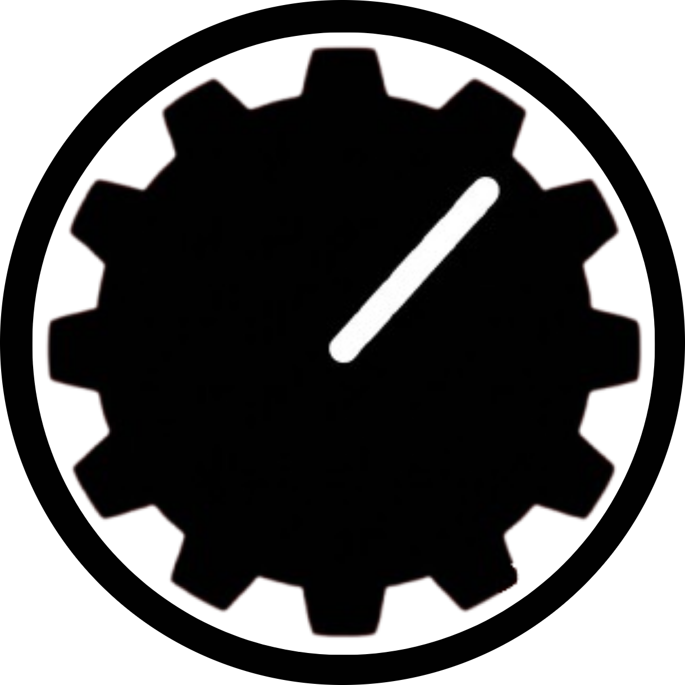

<div align="center">
  
  <h1>🎮 Fuzz — Game Platform</h1>
  <p><strong>Play, buy, and mod PC games — all in one place.</strong></p>

  
  
  
  
</div>

---

## 📖 Loyiha haqida (About)

**Fuzz** — bu Steam'ga o'xshash, to'liq brauzerda ishlaydigan (PWA) o'yin platformasi. 
Loyiha **Frontend-first** (Node.js backend talab qilmaydi) arxitekturasida qurilgan. Barcha ma'lumotlar `localStorage` va lokal JSON fayllar orqali boshqariladi.

### ✨ Asosiy xususiyatlar (Features):
- 🛒 **Store va Library:** O'yinlarni sotib olish va ularni kutubxonada saqlash.
- 💳 **Wallet (Hamyon):** Foydalanuvchi balansi va tranzaksiyalar tarixi (Valyuta: `$`).
- ⬇️ **Download Manager:** Steam'dagi kabi o'yinlarni o'rnatish jarayoni, real vaqtda tezlik va foiz ko'rsatkichi, Pause/Resume.
- 🎁 **Free Games:** $0.00 yoki 100% chegirmadagi o'yinlar avtomatik ravishda kutubxonaga qo'shiladi.
- 🌍 **3 tilli tizim (i18n):** O'zbek, Rus va Ingliz tillari (`lang.js`).
- 🔐 **Xavfsizlik:** QR login (mobil), Google OAuth va SuperAdmin panel.
- 🎨 **Steam-style Dizayn:** To'q qizil (`#5f0800`) mavzudagi zamonaviy, moslashuvchan (responsive) interfeys.
- 📱 **PWA (Progressive Web App):** Saytni telefonga yoki kompyuterga App sifatida o'rnatish imkoniyati. Faqat App rejimida chiqadigan maxsus Splash Screen.

---

## 📂 Papka strukturasi (Structure)

```text
fuzz/
├── frontend/                 # Asosiy sayt fayllari
│   ├── css/                  # Uslublar (global va layout)
│   ├── js/                   # Skriptlar (store, auth, downloads...)
│   ├── image/                # Rasmlar (logo, splash)
│   ├── sound/                # Ovozlar (notification.mp3)
│   ├── data/                 # Ma'lumotlar (games.json, bundles.json)
│   ├── game/                 # O'yin fayllari (Ravenfield.7z va h.k)
│   ├── index.html            # Bosh sahifa (Store)
│   ├── game.html             # Bitta o'yin sahifasi
│   ├── library.html          # Kutubxona
│   ├── downloads.html        # Yuklashlar markazi
│   ├── settings.html         # Sozlamalar
│   ├── wallet.html           # Hamyon
│   └── config.js             # Maxfiy sozlamalar (GitHub'ga yuborilmaydi)
├── data/                     # (Zaxira ma'lumotlar)
├── games/                    # (Asosiy o'yin fayllari)
├── .gitignore
└── README.md